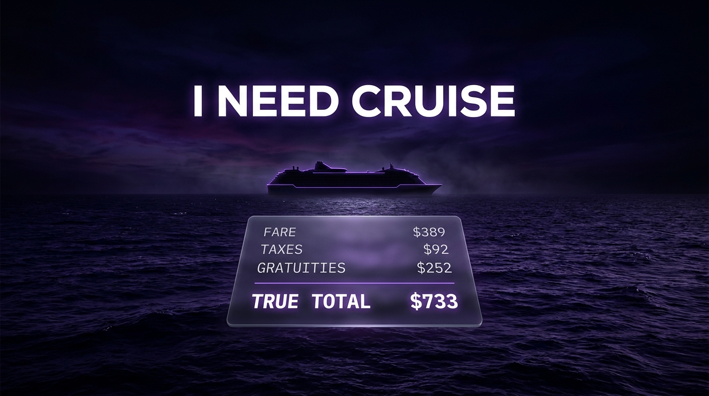

<p align="center">
  
</p>

<h1 align="center">I Need Cruise</h1>

<p align="center">
  A Claude Code skill that finds absurdly cheap cruises, then prices the flight that makes them real.<br>
  Ranks on <strong>true all-in cost per night</strong>: fare + taxes + the gratuities no booking site shows you.
</p>

<p align="center">
  <a href="#install"></a>
  <a href="LICENSE"></a>
  
</p>

Step-by-step guide and setup walkthrough: [I Need Cruise guide on charlieautomates.com](https://charlieautomates.com/free-resources/#ineedcruise)

---

## The problem

A cruise advertised at "from $389" is not $389.

```
Fare                 $389
Taxes & port fees     $92     +24%
Gratuities           $252     +65%
                    ──────
True total           $733     88% above the advertised number
```

Taxes are buried on most booking sites. **Gratuities appear in no data source at all**, and on a mass-market line they run $16 to $25 per person per day. On a 7-night sailing for two, that's $252 nobody quoted you.

Then there's the flight. Measured live: an `EWR → MIA` round trip for two came to **$478**, against a **$414** cruise. The flight was 54% of the trip. Every cruise site ignores it, because cruise sites don't sell flights and flight sites don't know about ships.

This skill does the arithmetic nobody performs, and ranks on the answer.

## What it actually does

1. Turns a loose sentence ("cheapest cruise out of Florida this winter") into a search plan
2. Shows you the plan and what it will cost, and **waits for your approval before spending anything**
3. Queries the cruise feed across several slices, since one broad query returns almost nothing
4. Converts everything to USD, because a single result set mixes GBP and EUR and ranking raw numbers inverts the order
5. Rebuilds the real price: fare + taxes + gratuities − onboard credit
6. Prices a round-trip flight for the top candidates, filtered so you can actually make the ship
7. Re-ranks on cruise **plus** flight, and shows every line of the math

### Repositioning cruises

The specialty. Twice a year, cruise lines move ships between seasons: Caribbean to Mediterranean in spring, Alaska to Mexico in autumn. Those crossings are one-way, nobody books them, and they get dumped at $40 to $70 a night.

The reason they're cheap is the reason nobody wants them: **you land in the wrong country**. So the skill prices the flight home from a different airport, which is exactly the step that decides whether the deal is real.

### The flight is not an afterthought

Cheapest is not always bookable. Three of five itineraries on a sailing day can be unusable at any price:

```
EWR → MIA, Sep 20 (ship sails 17:00)
  07:00 → 10:12  $478  ✅ recommended, 7h buffer
  11:25 → 14:41  $485  ⚠️  2h buffer, tight with bags
  15:38 → 18:52  $478  ❌ ship has sailed
  20:37 → 23:52  $478  ❌ ship has sailed
```

Outbound must land before noon on sailing day. Return must leave after 15:00 on disembarkation day. Port transfer time comes out of the buffer, because MCO is 50 minutes from Port Canaveral and Seward is 2.5 hours from Anchorage. If a cheaper fare breaks a window, the skill names it and rejects it out loud rather than quietly recommending it.

## Install

```bash
npx ineedcruise install --with-commands
```

That drops the skill into `~/.claude/skills/ineedcruise/` and writes the `/ineedcruise` slash command. Restart Claude Code and type `/ineedcruise`.

Other commands:

```bash
npx ineedcruise install --project      # install into ./.claude/ instead of globally
npx ineedcruise update                 # overwrite an existing install
npx ineedcruise uninstall --with-commands
npx ineedcruise where                  # print the install path
```

## Requirement: Apify

This is the one dependency, and it is not free. There is no free cruise API anywhere. Every official one (Sabre, Travelport, Traveltek, Revelex, Amadeus) is gated behind IATA or CLIA travel-agency accreditation. That gate is the entire reason no free consumer tool does this.

**1. Get an Apify account.** The free tier gives $5/month in credits, no card required.

> [Sign up for Apify](https://www.apify.com?fpr=charles) · use code **CHARLIE20** for a discount if you upgrade

**2. Connect the Apify MCP to Claude Code.** This is the recommended path, and how the skill is meant to be used:

```bash
claude mcp add --transport http apify https://mcp.apify.com
```

Then run `/mcp` inside Claude Code and authenticate. Once connected, the skill finds Apify on its own and there is no token to manage.

**Token fallback** if you'd rather not use MCP:

```bash
echo 'export APIFY_TOKEN="your_token_here"' >> ~/.zshrc
source ~/.zshrc
```

Restart Claude Code afterward so the variable reaches the process. Never paste a token into a chat window; it persists in the transcript.

Not sure which you have? Run `/ineedcruise setup` and it will check both paths, verify with a live run, and tell you exactly what's working.

### What a search costs

| Item | Cost |
|---|---|
| Cruise search, 5-8 slices at Apify's $0.10 per-run floor | $0.50 - $0.80 |
| Flight pricing, 3-5 lookups at ~$0.01 | $0.03 - $0.05 |
| **Per search** | **~$0.55 - $0.85** |

That's roughly **6 to 9 searches a month** on the free tier. The skill quotes the cost before every run and waits for you to say go. It also reports what the run actually spent when it finishes.

Both actors run on your own Apify account:

| Purpose | Actor |
|---|---|
| Cruise sailings | `vulnv/cruise-data-feed` |
| Flights | `memo23/google-flights-scraper` |

## Using it

```
/ineedcruise
```

Then say what you want. You do not need a destination; not having one is the point.

```
"Cheapest cruise out of Florida this winter"
"Repositioning crossing to Europe, two weeks, under $1500"
"Somewhere warm, 7+ nights, cheap as possible"
"I want to get to Europe cheap"
```

It will ask for your home airport, because flights are part of the ranking and leaving them out makes the answer wrong rather than merely incomplete.

## What it will not do

- **Book anything.** It surfaces sailings and links out. You book.
- **Claim complete coverage.** The cruise feed returns a hard 5 results per query no matter what you ask for. The skill works around it by slicing, and it always tells you how many slices it searched.
- **Guess a fee.** If a cruise line isn't in the gratuity table, it says gratuities are unknown for that line instead of inventing a number.
- **Invent a fare.** Google Flights publishes about 11 months out. Beyond that you get a labelled range and a provisional total, never a made-up price.
- **Automate hidden-city ticketing, Skiplagged routing, or fuel dumps.** It will explain them if you ask. It will not build them, because airlines detect it, ban accounts, and void miles.
- **Scrape sites that said no.** Cruise Critic blocks ClaudeBot by name and Vacations To Go disallows it in robots.txt. Neither is used.

## Honest limits

- **Gratuity rates are estimates**, last reviewed 2026-07-25. Lines adjust them annually and rates vary by cabin tier and region. Every brief prints that date and tells you to confirm at booking.
- **The cruise actor is small.** `vulnv/cruise-data-feed` had 6 total users at time of writing. 100% success rate, but a single maintainer with low usage is a real bus-factor risk.
- **Prices move.** Fares are scraped live at run time, not held. Treat every number as a candidate to verify, not a guarantee.
- **Solo travellers pay more.** Cruise fares are quoted per person at double occupancy, and the single supplement runs 150-200%. The skill says so explicitly rather than letting you find out at checkout.

## License

MIT. See [LICENSE](LICENSE).

Built by [Charles J Dove](https://charlieautomates.com) · [Charlie Automates](https://charlieautomates.com/free-resources/)
